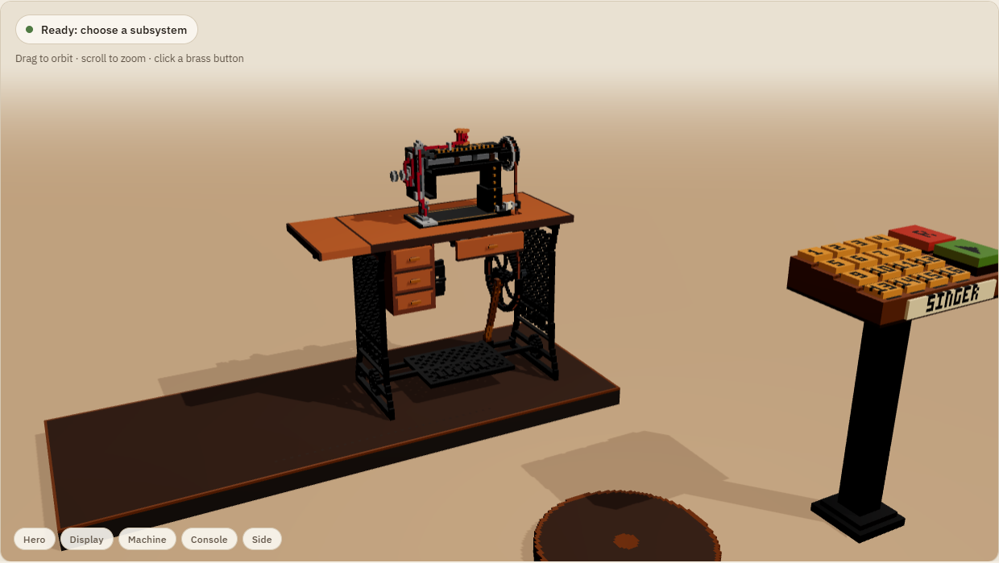
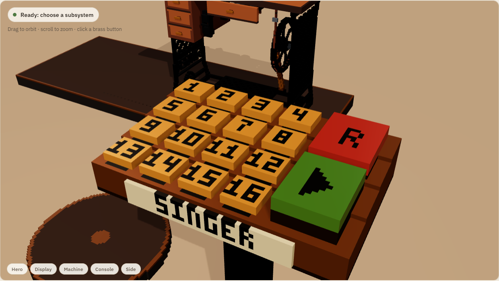
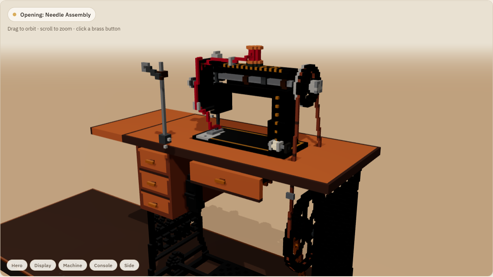
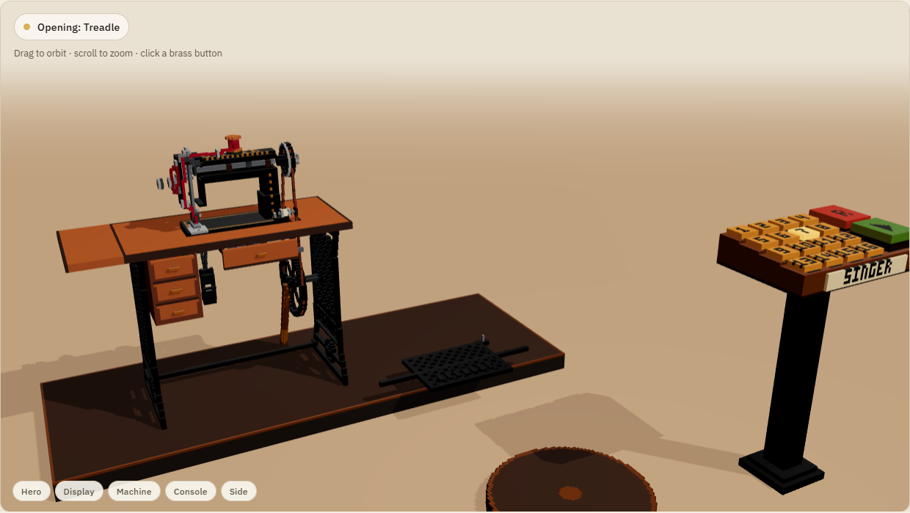
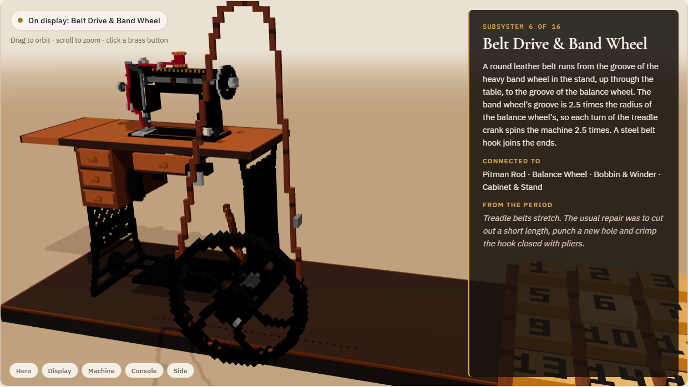
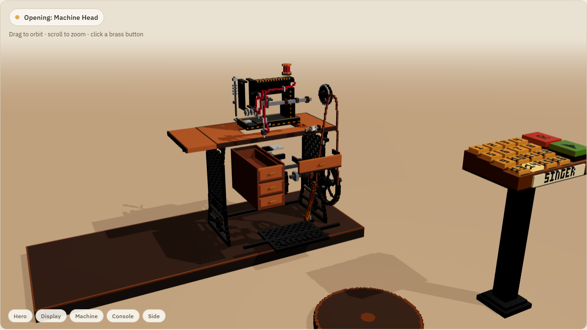
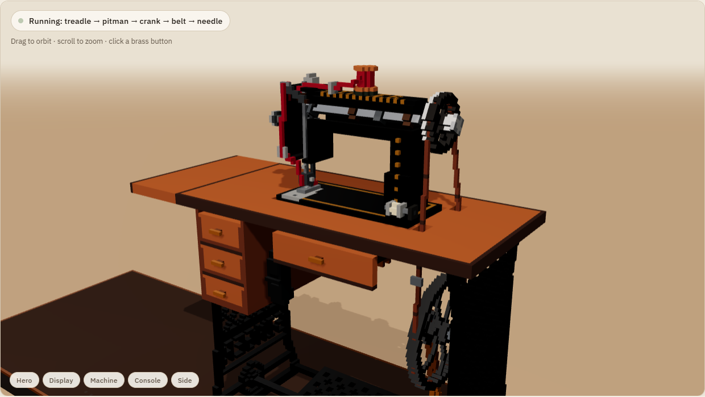
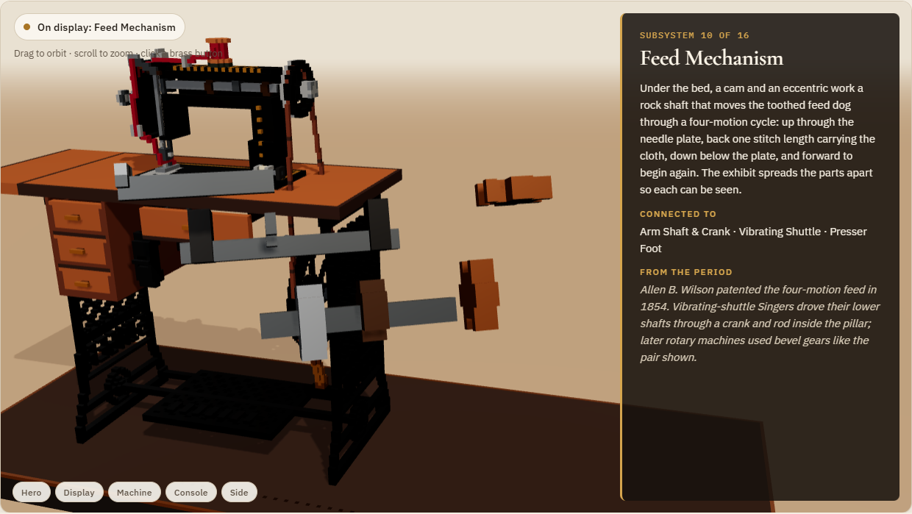
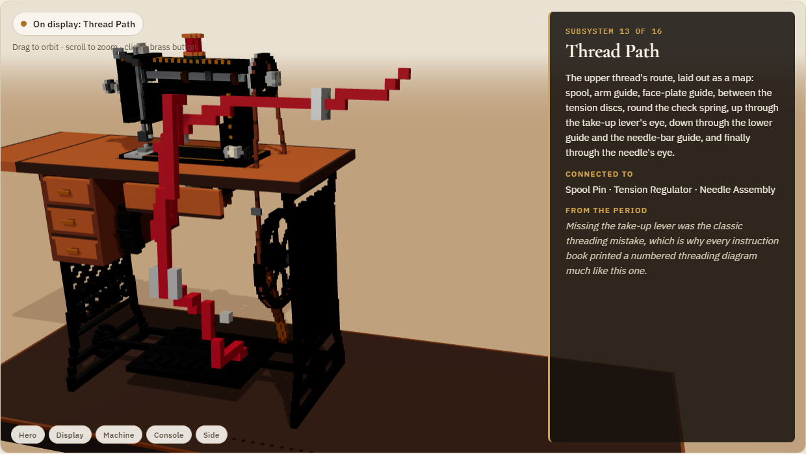

# Singer Treadle Exhibit: a Teardown mod

An interactive museum engineering exhibit of an antique **Singer treadle sewing machine** (c. 1880–1915)
for [Teardown](https://teardowngame.com). Sixteen mechanical subsystems, sixteen brass buttons. Press
one and that part withdraws along the path it was assembled by. The rest of the machine slides aside
as one rigid group, the part rides forward to a display point and an info panel explains what it does,
what it connects to, and a fact from the period. Press again and it all goes home.

Nothing explodes, nothing breaks, nothing is driven by physics. Every motion is a pure function of
time, so the exhibit behaves identically every time.

**▶ Web edition and project site: <https://simsi2027.github.io/Singer-Treadle-Teardown_F/>.** The same
voxels and the same choreography, running in the browser.



| Console | Withdraw | Slide aside | On display |
|---|---|---|---|
|  |  |  |  |
| **Frame mode: parts make way** | **RUN** | **Feed mechanism** | **Thread path** |
|  |  |  |  |

> Screenshots are rendered from the web edition by `tools/screens/capture.mjs`, which loads exactly
> the voxel data the mod ships. They are not in-game captures (see [Roadmap](ROADMAP.md)).

## Features

- **16 subsystems**, one body each: needle assembly, presser foot, bobbin winder, vibrating shuttle,
  balance wheel, belt drive & band wheel, treadle, pitman rod, arm shaft, feed mechanism, tension
  regulator, spool pin, thread path, machine head, cabinet & stand, drawers.
- **Brass lectern console**: a 4×4 grid of numbered buttons, plus RESET and RUN.
- **Mechanical choreography.** Each part withdraws along its own multi-leg exit path, then the machine
  slides aside as a rigid group, then the part rides a cubic Bezier to the display point and sways
  ±12° so every side is seen. The **head** and **cabinet** (the castings everything lives in) use *frame
  mode*: every other part first withdraws to make way.
- **Articulation on display.** Drawers slide 60 % open, the drop-front swings down, the feed mechanism
  spreads apart, the shuttle race opens.
- **RUN.** One input, the band-wheel angle, drives everything for 6 s. The treadle rocks ±12°
  (solved by circle intersection), the pitman follows as a rigid link, the wheels turn at the exact
  2.5:1 belt ratio, the needle bar reciprocates and the shuttle swings. Four turns make ten stitches,
  so the run ends exactly at home.
- **Educational panel** for every subsystem: function, "Connected to", and a period fact.
- **Indestructible by construction.** Only Teardown's unbreakable palette groups are used.
- **Verified offline.** The real Lua script runs under Lua 5.1 against a stub API and the real
  prefab. 30 checks, including voxel-exact collision checks along every path.

## Installation

1. Download or clone this repository:
   `git clone https://github.com/SimSI2027/Singer-Treadle-Teardown_F.git`
2. Copy the folder into `Documents/Teardown/mods/`. The repository root *is* the mod root
   (`info.txt`, `prefab.xml`, `exhibit.lua`, `vox/`, `snd/`, `spawn.txt`).
3. Start Teardown → **Mod manager** → enable **Singer Treadle Exhibit**.
4. In a sandbox level open the **spawn menu** → **Exhibits → Singer Treadle Exhibit**.

## Controls

| In game | |
|---|---|
| Look at a console button (≤ 2.5 m) | highlights it: `[E] Inspect: <name>` |
| `E` | inspect that subsystem / run / reset |
| `E` on the same button | send it home |
| `E` on another button | current part goes home, then the new one comes out |
| `R` button (red) | reset from any state |
| `▶` button (green) | RUN the machine for 6 s (from rest) |

The web edition adds orbit and zoom, keys `1`–`0` for subsystems 1–10, `R` for reset, `Space` for run,
and an auto tour after 30 s of quiet.

## Architecture

```
tools/generate.py ──► vox/*.vox (55 models, 1 cm voxels)
  (dimensions →       prefab.xml (18 bodies, tags, anchors, lights)
   voxels; budgets)   exhibit.lua  ← only the GENERATED GEOMETRY block (centres, pivots, kinematics)
                      docs/assets/geometry.{bin,json} (web edition)

exhibit.lua  ── CONFIG · SUBSYSTEMS · pose(t) · state machine · RUN kinematics · UI
tools/run_tests.py ── runs exhibit.lua under Lua 5.1 + tools/stub_api.lua with the real prefab
                   ── writes docs/assets/exhibit.json (CONFIG/SUBSYSTEMS/GEOM) for the web edition
docs/viewer.js ── line-for-line port of exhibit.lua's pose functions and state machine (three.js)
```

| File | Role |
|---|---|
| `info.txt`, `spawn.txt` | mod metadata; spawn entry `prefab.xml : Exhibits/Singer Treadle Exhibit` |
| `prefab.xml` | generated. `<script>` wraps the exhibit so `Find*` sees only this instance |
| `exhibit.lua` | the exhibit: `CONFIG` and `SUBSYSTEMS` tables at the top, then poses, state machine, callbacks |
| `vox/`, `snd/` | generated models and sounds |
| `tools/` | generator, sound synth, cross-check, stub API, test suite, screenshot capture |
| `docs/` | GitHub Pages site + `CONVENTIONS.md`, `PLAN.md`, `README.md` (modding guide) |
| `tests/CHECKLIST.md` | manual in-game acceptance checklist |

Design decisions are documented in [docs/CONVENTIONS.md](docs/CONVENTIONS.md) (what the reference
repository does and the fallbacks used) and [docs/PLAN.md](docs/PLAN.md) (dimensions, timing,
budgets).

## Build

Requirements: Python 3.10+. For the tests: `pip install lupa` (Lua 5.1 runtime). For sounds: `ffmpeg`.
For screenshots: Node 20+.

```bash
python tools/build.py              # generate → crosscheck → 30 offline checks → sync site assets
python tools/build.py --sounds     # also re-synthesise snd/*.ogg
cd tools/screens && npm install && node capture.mjs   # re-capture docs/screenshots + preview.jpg
```

To preview the website locally: `python -m http.server -d docs 8000` → <http://localhost:8000>.

## Roadmap

See [ROADMAP.md](ROADMAP.md). Highlights: in-game screenshots and tuning in Teardown itself, an
optional slow-motion stitch-formation view, labels on the console's engraved strips.

## Licence

MIT, see [LICENSE](LICENSE). Singer is a trademark of its owner; this is an independent educational
model, not affiliated with or endorsed by The Singer Company or Tuxedo Labs.
