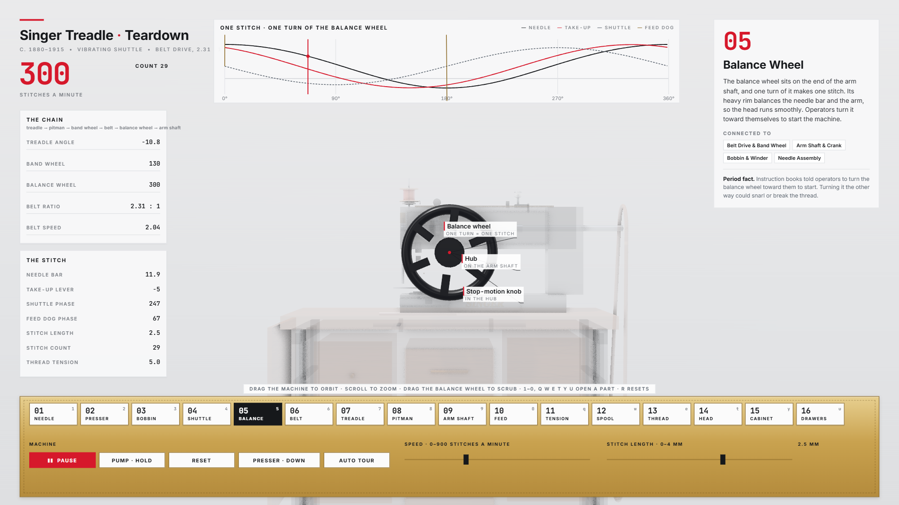
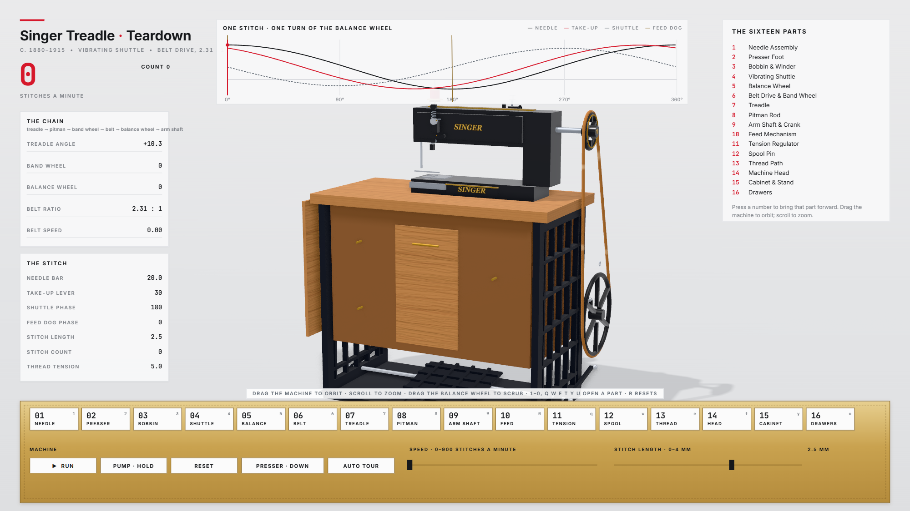
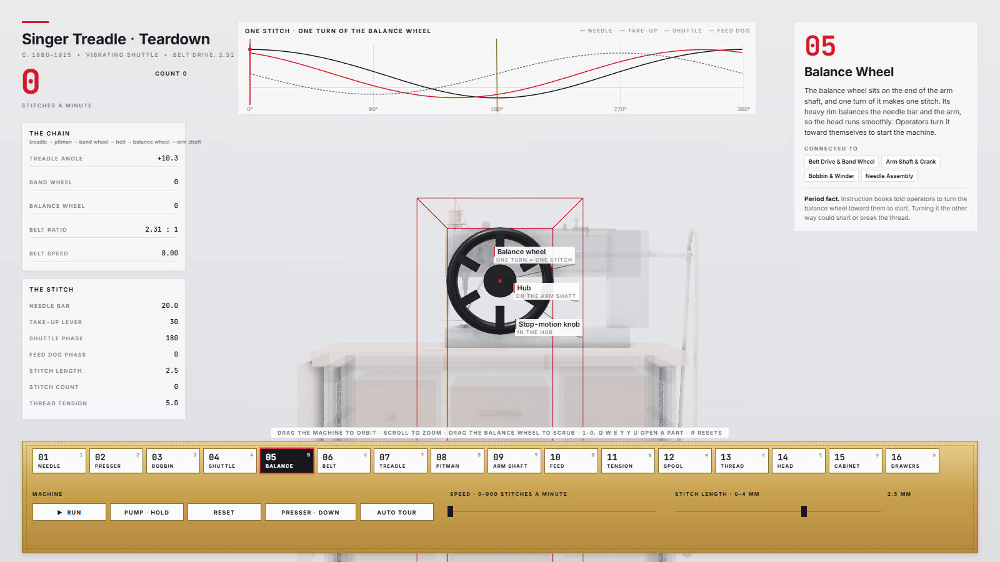
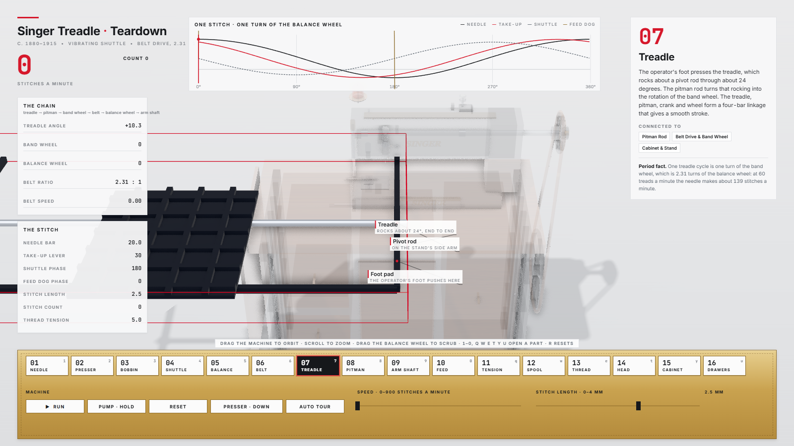

# Singer Treadle · Teardown

An interactive, offline simulator of an antique Singer treadle sewing machine (c. 1880–1915): cast-iron head,
vibrating shuttle, balance wheel, leather belt to a big band wheel, cast-iron treadle stand and an oak cabinet with drawers.
Press a number and that part comes forward to the middle of the screen, the rest of the machine fades, and a card explains
what the part does, what it connects to, and a period fact. Left alone, the page tours itself through the drive chain.

Built on the [teardown skill](https://github.com/elvarofficial/teardown): one machine, one page, one film.

- **Live exhibit (single HTML, runs offline):** `dist/singer-treadle.html`. Also published on the project site.
- **Project site:** <https://simsi2027.github.io/Singer-Treadle-Teardown_F/>
- **Film:** `docs/assets/film.mp4` (75 s, 60 fps, with a procedural score).

## Screenshots



| Overview | Balance wheel on display | Treadle on display |
|---|---|---|
|  |  |  |

## Features

- **Sixteen parts, one button each** (keys `1`–`9`, `0`, `Q W E T Y U`). A part comes forward, the rest ghosts, the camera frames it,
  callouts name its parts, and it keeps moving.
- **Real kinematics.** One master angle (the balance wheel) drives everything. The treadle is a four-bar linkage (24° swing),
  the belt ratio is 2.31 : 1, the needle stroke is 30 mm, the take-up lever leads the needle by 30°, the vibrating shuttle swings
  through the loop at the needle's bottom, and the feed dog moves the cloth only while the needle is out of it.
- **Numbers from the same solve.** Treadle angle, band and balance wheel rpm, belt speed, needle height, take-up angle,
  shuttle and feed phases, stitch length, stitch count, tension.
- **Controls.** RUN and PAUSE, a speed slider (0–900 stitches a minute), a stitch-length slider (0–4 mm), PUMP (hold), presser
  foot lift, RESET; drag the balance wheel to scrub the stitch; drag the machine to orbit; scroll to zoom.
- **Idle tour.** After 25 s of quiet the page tours the drive chain with captions. Any input takes over at once.
- **Deterministic.** A fixed 1/120 s simulation step: the same inputs give the same motion.
- **Offline.** One HTML file with three.js and the fonts inlined. No network requests at run time.

## Controls

| Action | Control |
|---|---|
| Open a part | click it, or press `1`–`9`, `0`, `Q W E T Y U` (pressing the open part again closes it) |
| RUN / PAUSE | `Space` or the RUN button |
| Speed | drag the speed slider; hold PUMP (or `P`) to pump faster |
| Stitch length | drag the stitch-length slider |
| Presser foot | `L` or the PRESSER button |
| Scrub the stitch | drag the balance wheel |
| Orbit / zoom | drag the machine / scroll |
| Reset | `R`, `Esc` or RESET |
| Auto tour | after 25 s of quiet, or the AUTO TOUR button |

## Architecture

```
sims/kit/                      the skill's runtime, warm-up, stage helpers (vendored)
sims/build.mjs                 esbuild bundle → teardown-out/dist/<name>.html (fonts and three inlined)
sims/capture.mjs               frame-accurate capture to mp4 or stills (Playwright)
sims/singer-treadle-shared/    the machine
  kin.js                       pure kinematics: solve(state) → every pose and panel number
  subsystems.js                the sixteen parts: ids, texts, facts, open views, callouts
  machine.js                   procedural geometry, posing, presentation and ghosting
  presenter.js                 which part is on display and how far (pure timeline)
  script.js                    the shared script: events, speed, captions (tour and film)
  stage.js                     studio, lights, shadows, occlusion pass, warm-up
  console.js                   the 1600 × 900 overlay: numbers, strip, card, callouts, brass plate
  live.js                      the page: fixed-step simulation, input, tour, quality tiers
  film.js                      the film: render(t) as a pure function of time
  materials.js                 materials and canvas textures (oak grain, belt, gold decal)
  score.py                     the procedural score on the film's timeline
sims/singer-treadle-live/      entry point of the page
sims/singer-treadle-film/      entry point of the film (timeline.json written by tools/timeline.mjs)
sfx/, run_sfx.py               the sound engine (vendored): pure-Python synthesis, −14 LUFS mastering
tools/                         release (copies the page), timeline, film, screenshots, crosscheck
tests/                         Playwright suite and the manual checklist
docs/                          the Pages site, CONVENTIONS, PLAN, research notes, review sheets, screenshots
```

Design notes: [docs/CONVENTIONS.md](docs/CONVENTIONS.md) (what the skill does, with quoted lines and the deviations) and
[docs/PLAN.md](docs/PLAN.md) (dimensions, timing, budgets, verification).

## Build, test and film

Requirements: Node.js 20 or newer. For the film: `ffmpeg` on the PATH and Python 3 (standard library only).

```bash
npm install && npx playwright install chromium   # dependencies and the test browser
npm run build                                    # dist/singer-treadle.html (and docs/exhibit.html)
npm test                                         # build, crosscheck, Playwright suite
npm run film                                     # the 75 s film with its score → docs/assets/film.mp4
npm run site                                     # docs/index.html from the exhibit's own texts
npm run screenshots                              # docs/screenshots/*.png from the live page
```

To preview the site locally: `python -m http.server -d docs 8000`, then open <http://localhost:8000>.

## Adding a seventeenth part

A new part touches six places. The crosscheck and the Playwright suite fail until all of them agree.

1. `sims/singer-treadle-shared/subsystems.js`: add an entry to `SUBSYSTEMS` (id, button, name, pivot, open view, callouts,
   connections, text, fact), about 25 lines, and a key to `BUTTON_KEYS`. Free keys include `a s d f g h i j k m n o x z c v b`; the
   keys `r`, `l`, `p`, space, `Esc` and the arrows are taken.
2. `sims/singer-treadle-shared/machine.js`: add its geometry as a block inside `createMachine` (the group is `G[id]`), about 10–30
   lines, and its posing in `update()` if it moves.
3. `sims/singer-treadle-shared/console.js`: make room for seventeen keys in the console's key row. `keyW` and `keyGap` are set for
   sixteen; seventeen keys need `keyW` of about 82 px to fit the 1,530 px plate.
4. `sims/singer-treadle-shared/script.js`: add a beat (and its caption) to the `REST` list, which the tour visits. The crosscheck
   requires a tour beat for every id.
5. `tools/crosscheck.mjs` and `tests/exhibit.spec.mjs`: add the id to the `FIXED` list in each, and update the expected count of sixteen.
6. Make its screenshot (`node tools/screenshots.mjs --only=<id>`), then run `npm test`.

Text that says "sixteen" (the console's index heading, the film's intro caption, this README and the site) is not generated and
needs a manual edit.

## Credits and licences

MIT, see [LICENSE](LICENSE). The teardown skill's kit, capture and sound engine are from
[whaleyxbt/claude-motion](https://github.com/whaleyxbt/claude-motion) (MIT) through the skill; the recorded samples are CC0
from Freesound (see `sfx/samples/SOURCES.md`). Notices: [THIRD_PARTY.md](THIRD_PARTY.md).

Singer is a trademark of its owner. This is an independent educational model, not affiliated with or endorsed by The Singer Company.
